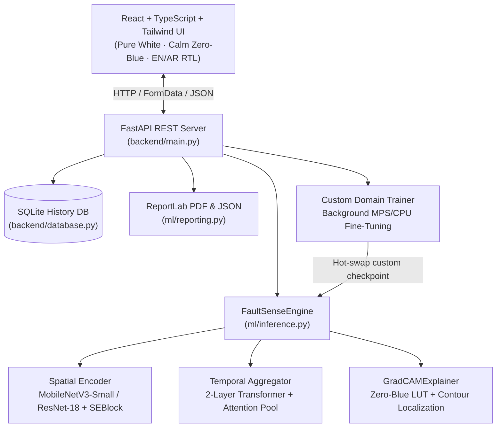
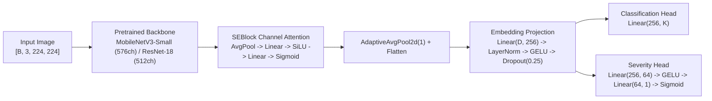
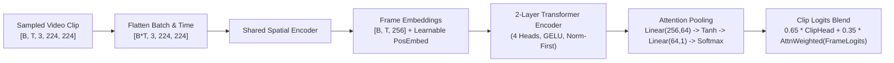

# FaultSense AI — System & Deep Learning Architecture

This document details the neural network architecture, spatio-temporal video processing pipeline, explainability engine, and full-stack software architecture of **FaultSense AI**.

---

## 1. High-Level System Architecture

---

## 2. Spatio-Temporal Deep Learning Model (`ml/model.py`)

FaultSense AI uses a unified dual-mode PyTorch architecture (`FaultSenseTemporalNet`) capable of both **single-frame spatial defect inspection** and **multi-frame temporal video analysis**.

### 2.1 Spatial Encoder (`FaultSenseSpatialEncoder`)

- **Target Layer for Grad-CAM**: `self.features[-1]` exposes the final high-resolution convolutional activation tensor before global pooling.
- **Squeeze-and-Excitation (`SEBlock`)**: Re-weights feature channels dynamically to amplify fine linear scratches, hairline cracks, and small solder bridges against noisy metallic/asphalt textures.
- **Dual-Head Multi-Task Objective**:
  $$\mathcal{L} = \mathcal{L}_{\text{CE}}(\hat{y}, y;\ \epsilon=0.05) + 0.35 \cdot \mathcal{L}_{\text{SmoothL1}}(\hat{s}, s)$$
  where $\epsilon=0.05$ applies label smoothing for calibrated confidence estimates and $s \in [0, 1]$ represents normalized fault severity.

### 2.2 Video Temporal Aggregator (`TemporalAttentionAggregator`)

- **Why Attention Pooling?** Faults in industrial conveyor feeds, dashcam road scans, or CCTV safety streams often appear only during a subset of frames. Temporal attention weights $\alpha_t$ highlight fault-bearing keyframes while suppressing benign frames.
- **Outputs**:
  - Clip-level fault class probabilities and calibrated severity score.
  - Per-frame fault probability timeline (`timeline[]`) and temporal attention weights (`temporal_attention`).
  - Top-3 peak fault keyframes ranked by $\alpha_t \cdot P(\hat{c} \mid x_t)$.

---

## 3. Explainable AI & Fault Localization (`ml/gradcam.py`)

1. **Gradient Hook Extraction**: `GradCAMExplainer` registers forward and backward hooks on `spatial.get_target_layer()`.
2. **Activation Map**: Computes channel importance weights $\omega_k = \frac{1}{HW}\sum_{i,j}\frac{\partial y^c}{\partial A^k_{i,j}}$, forms $\text{ReLU}(\sum_k \omega_k A^k)$, and bilinearly upsamples to $224 \times 224$.
3. **Calm Zero-Blue Lookup Table (`build_calm_lut`)**:
   - `0.00` → Warm Cream `#FAF9F6`
   - `0.35` → Honey Amber `#E6BE73`
   - `0.70` → Warm Terracotta `#C86A54`
   - `1.00` → Deep Crimson-Plum `#732937`
4. **Region Localization**: Thresholds normalized CAM ($\ge 0.46$), applies elliptical morphological closing, extracts up to top-4 contours, and draws corner-bracket bounding overlays with peak activation tags.

---

## 4. Two-Stage Training Pipeline (`ml/train.py`)

| Stage | Input | Optimizer & Schedule | Epochs | Device |
| :--- | :--- | :--- | :---: | :--- |
| **Stage 1: Spatial** | 790 train / 150 val / 160 test images (`224×224`) | AdamW (`lr=3e-4`, `wd=1e-4`), CosineAnnealingLR | 8 | Apple Silicon `mps` |
| **Stage 2: Temporal** | 160 train / 40 val video clips (`12×224×224`) | AdamW (`lr=4e-4`, `wd=1e-4`) on `temporal` head | 4 | Apple Silicon `mps` |

---

## 5. REST API & Persistence Contract (`backend/`)

| Method | Endpoint | Purpose |
| :--- | :--- | :--- |
| `GET` | `/api/health` | Hardware accelerator (`mps`/`cpu`), active model mode, class counts |
| `GET` | `/api/taxonomy` | All 4 domains and 10 built-in + custom fault classes |
| `GET` | `/api/model/metrics` | Training curves, confusion matrix, and per-class F1 metrics |
| `GET` | `/api/samples` | Built-in benchmark sample images (10) and H.264 videos (4) |
| `POST` | `/api/inspect/image` | Image inference + Grad-CAM + localized boxes + SQLite log |
| `POST` | `/api/inspect/video` | Temporal video inference + annotated H.264 MP4 + timeline + keyframes |
| `GET` | `/api/history` | Filterable SQLite audit log (`domain`, `severity`, `limit`) |
| `GET` | `/api/reports/{id}/pdf` | Download executive ReportLab PDF inspection report |
| `GET` | `/api/reports/{id}/json` | Download structured JSON inspection payload |
| `POST` | `/api/train/custom` | Launch background custom domain fine-tuning + hot-swap |
| `GET` | `/api/train/status` | Poll live epoch progress and validation accuracy |
| `POST` | `/api/model/switch` | Switch inference engine between `builtin` and `custom` |

---

## 6. Annotated Video Rendering (`ml/inference.py`)

For every video inspection, OpenCV composites a frame-by-frame calm HUD strip displaying the active frame prediction, confidence percentage, temporal attention score, and progress scrub bar, then transcodes via `ffmpeg` (`libx264`, `-pix_fmt yuv420p`, `+faststart`) for universal browser playback.
